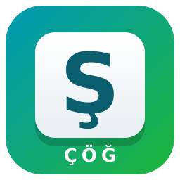
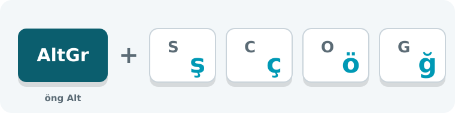

<div align="center">



# Yangi özbek harflari — Linux

**Linux uçun yangi özbek alifbosi harflari: Ş Ç Ö Ğ**

[](https://github.com/nazmiddin255/yangi-uzbek-harflari-linux/releases/latest)
[](https://github.com/nazmiddin255/yangi-uzbek-harflari-linux/actions)
[](LICENSE)
[](https://github.com/nazmiddin255/yangi-uzbek-harflari-linux/releases)

<br>

[](https://github.com/nazmiddin255/yangi-uzbek-harflari-linux/releases/latest/download/yangi-uzbek-harflari.deb)

[](https://github.com/nazmiddin255/yangi-uzbek-harflari-linux/releases/latest/download/yangi-uzbek-harflari-linux.tar.gz)

<sub>🪟 Windows uçun: <a href="https://github.com/nazmiddin255/yangi-uzbek-harflari-windows">yangi-uzbek-harflari-windows</a></sub>

</div>

---

> [!WARNING]
> **Vaqtinçalik yeçim.** Bu şaxsiy, bepul va oçiq kodli loyiha. Rasmiy paket çiqqunça
> foydalanib turiş uçun qilingan. Kafolat berilmaydi (MIT litsenziyasi).

## ⌨️ Qanday yoziladi

<div align="center">

</div>

| Tugmalar | Natija |
|---|:---:|
| **AltGr** + S | ş |
| **AltGr** + C | ç |
| **AltGr** + O | ö |
| **AltGr** + G | ğ |
| **AltGr** + Shift + S / C / O / G | Ş Ç Ö Ğ |
| **AltGr** + \` | ʼ |

> [!TIP]
> **Caps Lock** yoqilgan bölsa, AltGr + S darhol **Ş** beradi — Shift kerak emas.

**AltGr** — klaviaturadagi **öng Alt** tugmasi. Qolgan hamma tugmalar oddiy inglizça (US) klaviaturadagi kabi.

## 📦 Örnatiş

### Ubuntu, Debian, Linux Mint, Pop!_OS, Zorin

**1.** Yuqoridagi **`.deb yuklab oliş`** tugmasini bosing.

**2.** Terminalda:
```sh
sudo apt install ./Downloads/yangi-uzbek-harflari.deb
```

**3.** Tizimdan çiqib qayta kiring (log out / log in).

**4.** Ilovalar menyusidan  **Yangi o'zbek harflari** ikonkasini bosing — klaviatura özi qöşiladi.

**5.** `Super + Space` bilan **O'zbek — yangi alifbo** ga öting va yozing!

✅ Tizim yangilanganda klaviatura öçib ketmaydi — paket uni özi qayta tiklaydi.

### Fedora, Arch, openSUSE va boşqalar

```sh
tar xzf yangi-uzbek-harflari-linux.tar.gz
cd yangi-uzbek-harflari-linux
sudo sh install.sh
```
Keyin 3–5 qadamlar yuqoridagi kabi.

> [!NOTE]
> Bu usulda tizim yangilanişidan keyin klaviatura yöqolsa, `sudo sh install.sh` ni qaytadan işga tuşiring.

## 🛠 Muammolar

<details>
<summary><b>Röyxatda boşqa "Uzbek" klaviaturasini tanlab qöydim</b></summary>

Röyxatda Linux'ning özining "Uzbek" va "Uzbek (Latin)" klaviaturalari ham bor — ularda yangi harflar yöq.
Bizniki: **O'zbek — yangi alifbo (Ş Ç Ö Ğ)**.
Eng oson yöli — ilovalar menyusidagi **Yangi o'zbek harflari** ikonkasini bosiş.
</details>

<details>
<summary><b>AltGr bosilganda heç narsa çiqmayapti</b></summary>

Compose tugmasi öng Alt'ga qöyilgan bölişi mumkin. Uni boşqa tugmaga özgartiring:
GNOME Tweaks → Keyboard → Compose Key.
</details>

<details>
<summary><b>Klaviatura işlamayapti yoki röyxatda çiqmayapti</b></summary>

Tizimdan çiqib qayta kiring yoki kompyuterni qayta yoqing. Yordam bermasa —
<a href="../../issues">Issues</a> böllimiga yozing.
</details>

## 🗑 Öçiriş

| Tizim | Buyruq |
|---|---|
| Ubuntu / Debian | `sudo apt remove yangi-uzbek-harflari` |
| Boşqa Linux'lar | `sudo sh uninstall.sh` |

## ✏️ Özgartiriş

Klaviatura bitta oddiy matn faylida: [`xkb/symbols/uzyangi`](xkb/symbols/uzyangi).
Xohlagança özgartiring va öz versiyangizni yasang:

```sh
sh scripts/build-deb.sh 1.0.1   # build/yangi-uzbek-harflari.deb yasaydi
```

## 📄 Litsenziya

[MIT](LICENSE) — bepul, xohlagança foydalaniş va özgartiriş mumkin.
